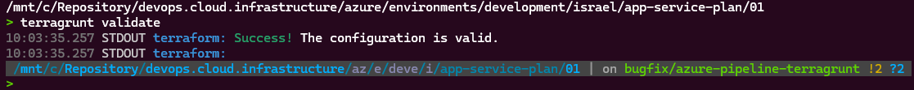

# Terraform/Terragrunt

## Configure CLI Cloud Access

### AWS

[AWS Guide](./documentation/AWS.md)

## Directory Structure

[AWS Tree Structure](./documentation/aws-tree.md)

## Terragrunt Examples - AWS

Working Branch == 'main'

### Build Production Environment

Add Profile 'octopusapp_dev', get aws_access_key_id, aws_secret_access_key, aws_session_token

```bash
aws configure set --profile octopusapp_dev region us-east-1
aws configure set --profile octopusapp_dev aws_access_key_id xxxxxxxxxxx
aws configure set --profile octopusapp_dev aws_secret_access_key xxxxxxxxxxx
aws configure set --profile octopusapp_dev aws_session_token xxxxxxxxxxx
```

### Check Whether the Configuration files are Valid

```bash
terragrunt validate --all
```

Example for Running Terragrunt Command



### Initiate your Working Directory for Other Commands

```bash
# New Command in version 0.99.3
terragrunt run --all init
```

### Show Changes Required by the Current Configuration

```bash
# New Command in version 0.99.3
terragrunt run --all plan
```

### Run Specify Module Terragrunt Directory

```bash
cd devops.cloud.infrastructure/aws/account_dev/development/il-central-1/dev-01/vpc

# New Command in version 0.99.3
terragrunt run --all plan
```

OR run terragrunt command for all modules in the directory with the '--terragrunt-include-dir' flag

```bash
terragrunt run apply --terragrunt-include-dir devops.cloud.infrastructure/aws/account_dev/development/il-central-1/dev-01/vpc/*
```

**Note** you can add '--parallelism=5' flag for running commands in parallel

---

## Import AWS Resources

<details>
### 🌍 Terraformer AWS Import Guide

**Terraformer** is a CLI tool that helps you **generate Terraform code** from existing cloud infrastructure.\
This guide walks you through using **Terraformer** to import AWS resources into **Terraform** configuration files.

### 🛠 Prerequisites

Before you begin, make sure you have the following installed:

- Terraform
- Terraformer
- AWS CLI configured with your credentials
- An AWS profile (e.g., `octopus_prod`) set up in your `~/.aws/credentials` file

### 🚀 Basic Usage

Here’s a simple command to import EC2 instances from AWS using Terraformer:

```bash
terraformer import aws --resources=ec2_instance --regions=us-east-1 --profile=octopus_prod
```

### 🔍 Command Breakdown

- `terraformer import aws`: Tells Terraformer to use AWS as the provider.
- `--resources=ec2_instance`: Specifies the resource type to import (you can import multiple types).
- `--regions=us-east-1`: Defines the AWS region to scan.
- `--profile=octopus_prod`: Uses the named AWS profile for authentication.

---

### 📁 Output Structure

After running the command, Terraformer will generate a folder structure like this:

```bash
generated/
└── aws/
    └── ec2_instance/
        ├── main.tf
        ├── variables.tf
        └── terraform.tfstate
```

- `main.tf`: Contains the Terraform resource definitions.
- `variables.tf`: Contains variable definitions used in `main.tf`.
- `terraform.tfstate`: A snapshot of the imported resources.

### Import the New Data to Terraform

add a block to your 'tf' file

```bash
import {
  to = reource.name (the resource in your terraform code)
  id = "aws-id" (the resource id number in AWS)
}
```

run ```terraform refresh``` to add the new data to the state

---
</details>

## Troubleshooting

Add log level to a terragrunt command

```bash
terragrunt validate --log-level debug
```

### Cleanup unnecessary files and folders

```sh
find . -type d -name ".terraform" -exec rm -rf "{}" \;
find . -type d -name ".terraform" -exec rm -rf "{}" \;
find . -type f -name ".terraform.lock.hcl" -exec rm -f {} \;
find . -type d -name ".terragrunt-cache" -exec rm -rf "{}" \;
```

**Congratulations!!! You have successfully set up your Terraform/Terragrunt environment and are ready to manage your AWS infrastructure efficiently.**

**Clone the `devops-kubernetes-clusters-manifests` repository to get started with the provided configurations.**
